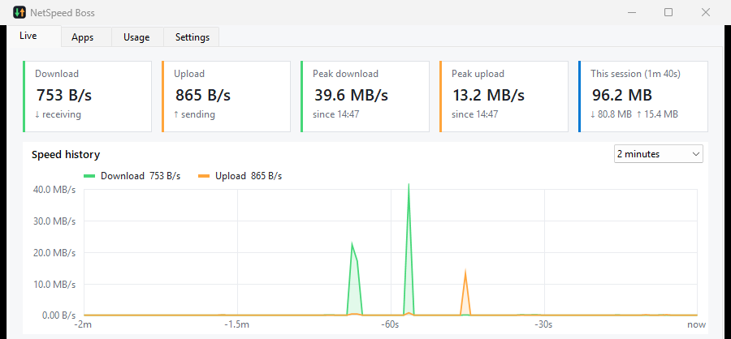

<p align="center">
  
</p>

<h1 align="center">NetSpeed Boss</h1>

<p align="center">
  <b>Your live internet speed, right on the Windows taskbar.</b><br>
  See which apps use your connection and how much data you use. Free, open source, tiny.
</p>

<p align="center">
  <a href="https://github.com/merchanthasan2/NetSpeedBoss/releases/latest/download/NetSpeedBoss-Setup.exe"><b>⬇ Download for Windows</b></a>
  &nbsp;·&nbsp;
  <a href="https://merchanthasan2.github.io/NetSpeedBoss/">Website</a>
  &nbsp;·&nbsp;
  <a href="https://github.com/merchanthasan2/NetSpeedBoss/releases">All releases</a>
</p>

<p align="center">
  
</p>

---

## Install

**Option 1: winget** (recommended)
```powershell
winget install merchanthasan2.NetSpeedBoss
```

**Option 2: installer.** Download [`NetSpeedBoss-Setup.exe`](https://github.com/merchanthasan2/NetSpeedBoss/releases/latest/download/NetSpeedBoss-Setup.exe) and run it.

**Option 3: portable.** Download the `portable.zip` from [Releases](https://github.com/merchanthasan2/NetSpeedBoss/releases), unzip it anywhere, and run `NetSpeedBoss.exe`.

Works on Windows 10 and 11 (64-bit). **No administrator rights needed.**

> **"Windows protected your PC"?** New apps that aren't code-signed yet trigger SmartScreen. Click **More info → Run anyway**.
> Every release is built automatically from this source code by [GitHub Actions](.github/workflows/release.yml).

## Get started in 3 steps

| | |
|---|---|
| **1. Install** | Use one of the options above. NetSpeed Boss starts right away. |
| **2. Look at your taskbar** | Your live **▼ download** and **▲ upload** speed sits next to the clock. Drag it left or right to move it. |
| **3. Explore** | **Double-click** the meter to open the dashboard. **Right-click** it for every option (bold text, units, colors...). |

## Features

- **Taskbar speed meter.** Blends into the taskbar, follows light and dark mode, and hides for full-screen games and when the taskbar auto-hides.
- **Make it yours.** Bold text, any font and size, custom colors, bytes (MB/s) or bits (Mbps), and a refresh rate from 0.5 to 5 s.
- **Live speed graph.** The last 1–10 minutes, with a hover read-out plus peak and session totals.
- **Apps tab.** Every program on the network, its speed and totals, and each server it connects to, with host names.
- **Data usage.** Today, yesterday, this month, the last 30 days and all time, with a daily chart and CSV export.
- **Monthly data cap.** Set your plan's limit and billing day, and get warned when you reach it.
- **Floating meter.** An optional always-on-top mini meter with a background graph that snaps to screen edges and can be click-through.
- **Private and lightweight.** A native app of about 120 KB using almost no CPU. No account, no telemetry, no ads.

### Per-app speeds (optional admin mode)
Windows only lets administrators read live per-app network traffic. Right-click the meter and choose
**Restart as administrator** to see exact download and upload speeds per app, covering TCP and UDP (games, calls, streaming).
Without admin, the Apps tab still lists which apps are connected and where to.

## FAQ

<details><summary><b>Will it slow down my PC or internet?</b></summary>

No. It reads the traffic counters Windows already keeps, about once a second. It never sends or downloads anything itself.
</details>

<details><summary><b>Where are my settings and history stored?</b></summary>

Only on your PC, in `%APPDATA%\NetSpeedBoss\`: `settings.ini`, `usage.csv` (one line per day), and `error.log` (only if something goes wrong).
</details>

<details><summary><b>How do I update or uninstall?</b></summary>

`winget upgrade merchanthasan2.NetSpeedBoss` or run a newer installer.
Uninstall from **Settings → Apps → NetSpeed Boss**, or `winget uninstall merchanthasan2.NetSpeedBoss`.
</details>

<details><summary><b>The meter disappeared</b></summary>

Right-click the tray icon (the ▼▲ arrows by the clock) and make sure **Show speed on taskbar** is ticked. Use **Reset positions** if you dragged it somewhere odd.
</details>

## Build from source

No SDK or Visual Studio needed. It uses the C# compiler that ships with Windows.

```powershell
powershell -ExecutionPolicy Bypass -File build.ps1                       # -> bin\NetSpeedBoss.exe
powershell -ExecutionPolicy Bypass -File build.ps1 -Version 1.2.0 -Installer   # + dist\ installer & zip (needs Inno Setup 6)
```

| File | What it does |
|---|---|
| `src/TaskbarMeter.cs` | Taskbar read-out (per-pixel transparent window docked beside the notification area) |
| `src/FloatingMeter.cs` | Floating always-on-top meter |
| `src/NetMonitor.cs` | Adapter counters → speeds (64-bit counters; auto / all / specific adapter) |
| `src/ProcessMonitor.cs` | Per-app traffic (ETW `Microsoft-Windows-Kernel-Network` + TCP connection table) |
| `src/UsageStore.cs` | Daily usage history |
| `src/TrayApp.cs` | Tray icon, menu, update loop |
| `src/Dashboard.cs`, `src/Controls.cs` | Dashboard UI and charts |
| `installer/NetSpeedBoss.iss` | Inno Setup installer (per-user, no UAC) |
| `winget/make-manifests.ps1` | Generates the winget manifest for a release |
| `docs/` | The project website (GitHub Pages) |

## Releasing (maintainers)

1. Push a tag: `git tag v1.0.1 && git push origin v1.0.1` (or run the **Release** workflow manually).
2. GitHub Actions builds the app, installer and portable zip, publishes the Release, and generates the winget manifests.
3. If the `WINGET_TOKEN` repository secret is set (a classic GitHub token with `public_repo` scope), the new version is submitted to [microsoft/winget-pkgs](https://github.com/microsoft/winget-pkgs) automatically.

## License

[MIT](LICENSE). Free to use, modify and share.
